# Log

Newest first.

## 2026-11-23: brief 02d, walls and surfaces (built, waiting on a migration and a deploy)

**Blocked on Munzir for two steps:**
1. Apply `supabase/migrations/20261123_02d_room.sql`. It adds one column, `ssx_profiles.room` (jsonb). Without it the app still loads and shows the default room, but wall and texture edits fail with `something broke`.
2. Push and deploy. After that, re-normalize your current avatar (see part 0).

Everything below was checked locally. That covers unit tests, plus the UI in headless Chrome at 390 x 844, 1080 x 1920, 1920 x 1080 and 1280 x 720, against mocked Supabase data and a fake `/api/room`. Touch pinch and drag were sent as real touch events. **No real nano banana texture run has happened yet**, and the done-when walkthrough is yours to do in the app.

| Done when | Result |
| --- | --- |
| From inside the app: add a wall, remove one, make one tall, floor to asphalt, walls to siding, looks like `goal-placeholder-room.png` | **Not run for real yet** (needs the migration and a deploy). Every step works against the fake API: `[ edit ]`, tap a grid line, `[ add wall ]`, `[ tall ]`, `[ remove ]`, `[ texture ]`, then asphalt on the floor and siding on `all walls`. To get the goal look, remove the right back wall and keep the left one: [screens/02d-goal-portrait.png](screens/02d-goal-portrait.png). |

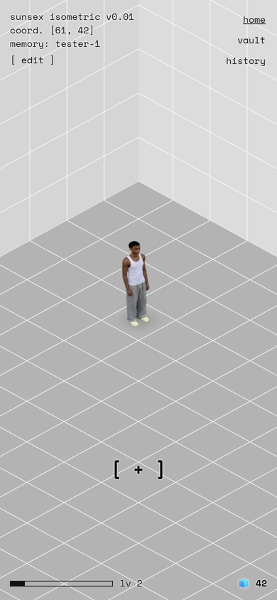 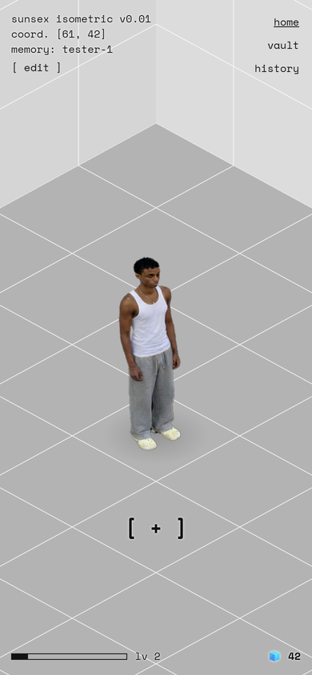 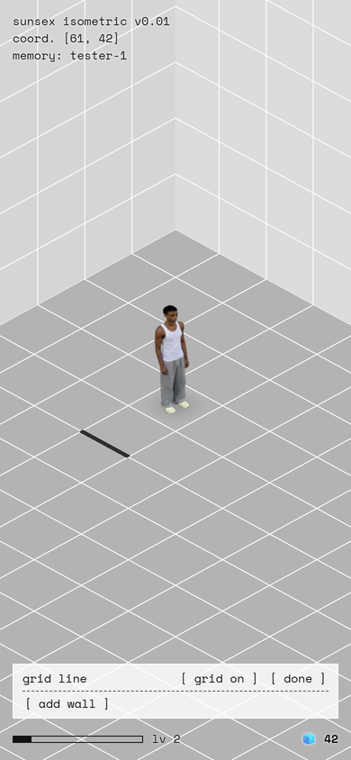 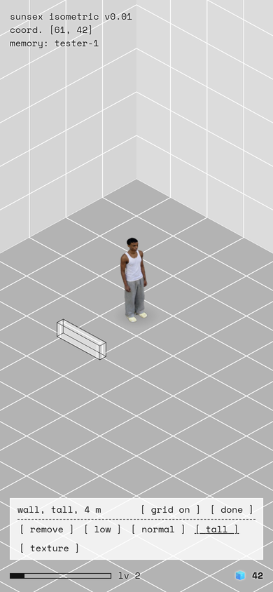 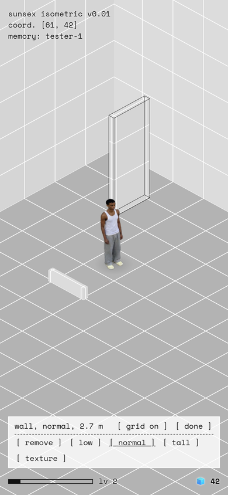 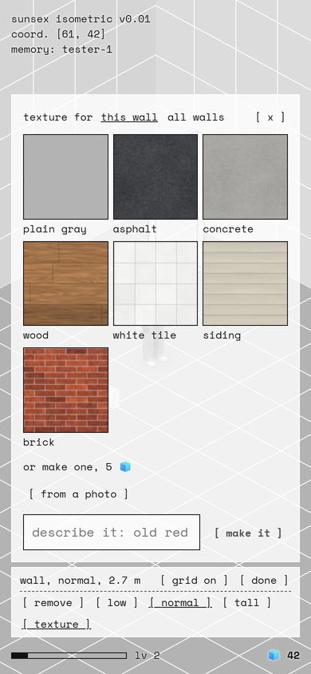 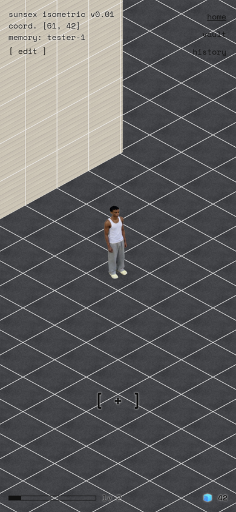

### What was built

- **Part 0, avatar shadow.**
  - `normalize.shadow.opacity` is now 0, so new avatars come out with no baked shadow.
  - The room draws a soft 3D floor shadow under the ground point instead. It uses the same texture as the box shadows and is sized to the avatar's height (`avatar.shadow` in `camera.json`).
  - **Presets keep their hand-made shadows and get no 3D shadow.** That was simpler than editing the PNGs. Only generated avatars get the 3D one.
  - New tool `renormalizeAvatar` (exposed as `/api/avatar` action `renormalize`). It re-runs the normalizer on an avatar's saved cutout: no generation, no cubes, written under a new file name so no cache keeps the old picture.
  - **Not run on your avatar yet**, because it needs the deploy. Your current avatar is the kept v2. The unkept v1 still has its baked shadow.
- **Part 0b, backdrop walls.**
  - The default room is the two back edges as `height: "backdrop"`. Each backdrop's height is computed from the frustum so its top passes the top of the screen at 1x: about 7 m on a phone, 5.6 m in landscape, up to about 10 m for walls at the far edge of a 12 m room.
  - Floor and walls share one shader. The white 1 m grid is drawn in each face's own plane, with the same width (1 css px) and opacity (0.7) as the floor.
  - A texture replaces the plain color and the grid stays on top. `grid on / off` hides both.
  - Walls get a little light so the two back walls read apart.
- **Part 0b, camera moves.**
  - Only zoom and pan move. The numbers are in `camera.json` `moves`.
  - Tapping the avatar eases over 0.6 s to 2x on it. Tapping it again, or the empty floor outside edit mode, eases back to 1x.
  - Pinch zooms between 1x and 3x and drag pans. Past a limit the view moves a third as far, then eases back.
  - Pan never leaves the 1x frame, so the bake framing is always the outer edge. On desktop the mouse wheel zooms.
  - [screens/02d-pinch.png](screens/02d-pinch.png)
- **Edit mode.**
  - `[ edit ]` sits under the HUD lines on home. In edit mode the tabs and `[ + ]` hide and grid lines go to full white.
  - A thin bar shows what is selected and its actions: `[ add wall ]`, or `[ remove ] [ low ] [ normal ] [ tall ] [ texture ]` for a wall, `[ texture ]` for the floor. It also has `[ grid on ]` and `[ done ]`.
  - Taps near a grid line pick that 1 m segment. Taps on a wall pick the segment under your finger. Anywhere else picks the floor.
  - Edits show instantly and save in order. If one fails, the room reloads from the server.
- **Tool `editWalls({ userId, ops })`** (`api/_lib/tools/editWalls.ts`). Ops are add, remove or height on `[i, j, 'x' | 'z']` edges, saved on `ssx_profiles.room`.
  - The rules live in `shared/room.ts`, used by the server and the client alike.
  - Walls are 0.15 m thick and run half a thickness past each end, so corners close. Neighbouring segments with the same look are drawn as one box.
- **Cutaway.** A segment whose middle is on the camera side of the player renders as a 0.3 m stub. Its real height stays in the data.
- **Tool `makeSurface({ userId, target, preset? | photoUrl? | prompt? })`** (`api/_lib/tools/makeSurface.ts`).
  - Presets are free and apply at once. The seven presets (plain gray, asphalt, concrete, wood, white tile, siding, brick) are in `public/surfaces/`, made by `scripts/make-surfaces.ts` and seamless by construction: [screens/02d-surface-presets.png](screens/02d-surface-presets.png).
  - A photo or a description costs `costs.surface` (5, added to `cubes.json`). It starts a job on nano-banana-pro with the brief's prompt at 1:1, 1K.
  - When the job finishes, the result is cut square, its edges blended so it repeats cleanly, its saturation set to 0.85 and contrast to 0.88, then saved to `{user_id}/surfaces/`. Cubes are taken only after that, as with the avatar.
  - Everything is in `config/surfaces.json`.
- **`/api/room`**, one function: `load`, `walls`, `photo` (upload slot), `surface`, `status`. The job and storage helpers moved to `api/_lib/jobs.ts`, shared by the avatar and surface tools.
- **Tests and build:**
  - 18 new tests (room rules, edge blending, the surface and walls tools with mocks, camera picking and limits), 59 in total.
  - The avatar guide test was out of date after the `avatar-template.png` change; it now reads the guides from config.
  - Typecheck and build pass. The main bundle grew from 469 to 484 kB.

### Things I had to decide (please check)

- **Brief conflict:** the Walls section says the default room is "the two back edges, 2.7 m". Section 0b says the default walls are `height: "backdrop"`. I went with 0b, since it is the newer note.
- **Walls sit centered on grid lines.** The old back walls sat just outside the 6 x 6 floor; now the back row of tiles loses 7.5 cm.
- **Cutaway covers every segment on the camera side of the player** (Sims style), not only the ones that would overlap the avatar on screen. Otherwise a long front wall would still block most of the room.
- **Room limit:** walls can go on grid points -3 to 9 on both axes, a 12 x 12 m area centered on the default room.
- **`all walls` sets one wall texture for the room**, which walls added later also get. A single wall can still have its own texture.
- **`grid on / off` is remembered per device**, not saved in the room. If the bake (02f) should respect it, it belongs in `room`.
- **The presets are generated patterns, not photos.** Drop real 1 m photos into `public/surfaces/` with the same names to replace them.
- **HUD readability:** I added a faint white halo behind the HUD, tabs, `[ + ]` and the level bar. Without it the black text disappeared on the asphalt floor. Please check that it fits the visual rules.
- **Goal look:** the goal image has the wall close behind the avatar and running past the top of the screen. A player-made wall maxes out at 4 m (`tall`), which does not reach the top. Getting closer would need either a `backdrop` choice in the height actions or a movable player tile. I left heights as the brief lists them.
- **In landscape, the backdrops only span the 6 m room**, so floor shows beyond their ends on both sides.

### Not done

- Long-press and slide to add several segments (nice to have).
- `bake now?` when leaving edit mode (VISION-scene.md). There is no bake until 02f.
- A real photo or describe texture run, and re-normalizing your avatar. Both need the migration and the deploy.

## 2026-11-22: brief 02c, avatar creator (built, waiting on the migration for real runs)

**Blocked on one step from Munzir:** apply `supabase/migrations/20261122_02c_avatar_creator.sql`. Until then the maker cannot run for real. The app still loads without it: the room shows the placeholder and the avatar section says `placeholder`.

Everything below was checked locally: unit tests with mocked Supabase and Replicate, the normalizer on real preset PNGs, and the UI in headless Chrome at 390 x 844 against mocked data. **No real Replicate run has happened yet**, so the 3 logged test runs the brief asks for are still to do (see the end of this entry).

| Done when | Result |
| --- | --- |
| Munzir uploads a selfie and height and sees himself correctly sized and planted, no code touched | **Not run yet** (needs the migration, then a deploy). The whole flow works against mocks: Vault > avatar > `[ make my avatar ]` > photos, height, price > `...` over the head > `your avatar [ keep ] [ try again ]`. |
| Template overlay: ankles on the cross, head on the right height line | **Pass on simulated cutouts.** Three presets scaled up onto a 1536 x 2752 transparent canvas at random size and position, then normalized to 1.80, 1.65 and 1.45 m: heads land on their height lines, ankles on or within about 20 px of the cross. [screens/02c-normalize-overlay.png](screens/02c-normalize-overlay.png) |
| 3 test runs logged (photos in, PNG out) | **To do** once the migration is applied. |

 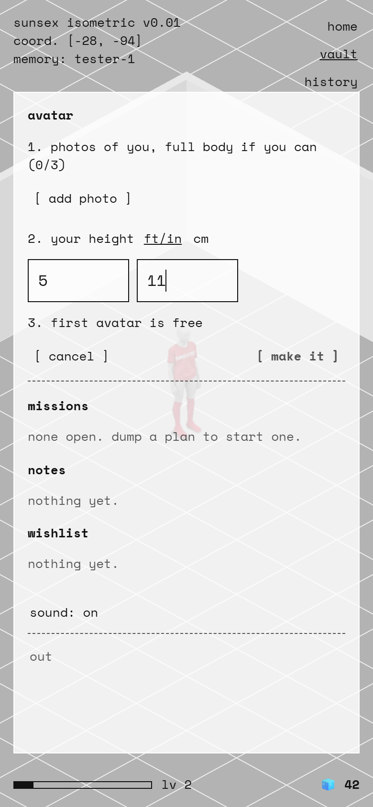 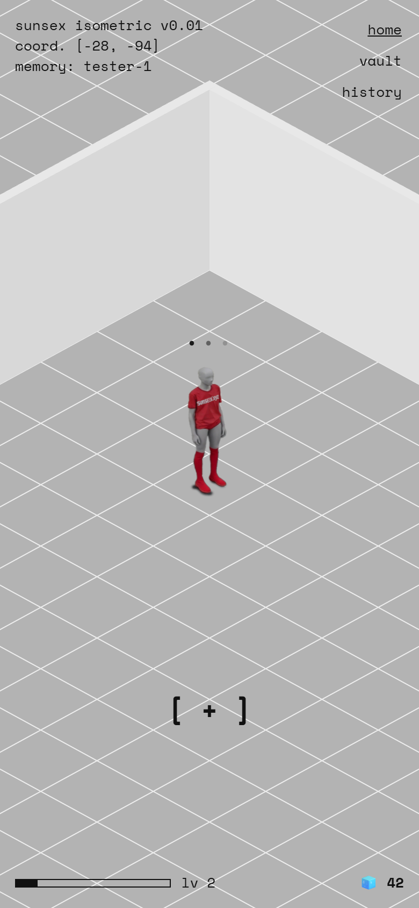 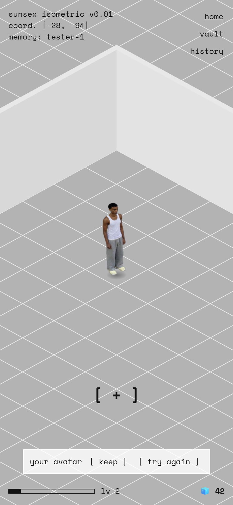 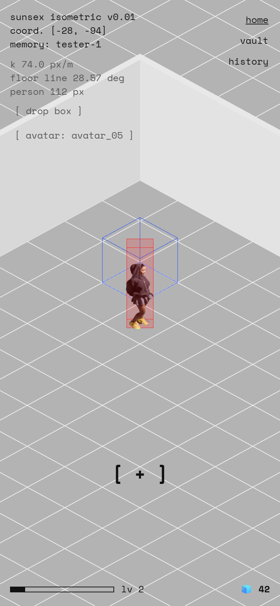

### What was built

- **Avatar files (part 0):** `avatars.json` lists all eight PNGs, including the placeholder and `avatar_07_munz4rmDressup`, with no scale fields. New players stand as `avatar_00` (placeholder). `?debug=cam` adds `[ avatar: ... ]`, which cycles through the presets and back to `mine`.
- **Migration:** a private storage bucket `ssx` (players read only their own `{user_id}/` folder; nothing uploads from the client except through one-time signed slots made by `/api`). Also `ssx_jobs` for async AI jobs (one working job per player and kind, enforced by a unique index), plus `height_m`, `raw_path`, `cutout_path` and `job_id` on `ssx_avatars`, and `active_avatar_id` on `ssx_profiles`.
- **Tool `api/_lib/tools/createAvatar.ts`:** `createAvatar({ userId, photoUrls, heightM })` checks photos, height and price, creates the job, and starts nano-banana-pro with the two guides first, then the photos, plus the brief's prompt. `advanceAvatarJob` moves it one step per poll: generation done > save the raw file > start the cutout; cutout done > save it > normalize > upload > `ssx_avatars` row > set active > charge. It also has `keepAvatar`, `discardAvatar` and `avatarPrice`. Each step claims its job row first, so two polls at once cannot double-start or double-charge. A step that dies mid-way fails after 2 minutes, and any job older than 15 minutes fails.
- **Normalizer `normalizeAvatar.ts` (sharp):** finds the figure by alpha, finds the ground point, scales so ground-to-head = `height_m x 620 / 1.8`, places the ground point at (400, 875) on 800 x 1000, and adds a soft contact shadow. `npx tsx scripts/normalize-avatar.ts <cutout> <m> <out> --overlay` re-runs it locally for free. `--check-presets` measures every preset against the cross.
- **`/api/avatar`:** one function with the actions `prepare`, `create`, `status`, `keep` and `discard`. The client polls every 3 s and picks a working job back up after a reload.
- **Models and prompt live in `config/avatar.json`**, so the generator, cutout model and normalize numbers can change without code.
- Tests: 15 new (normalizer, job flow with mocks, height parsing), 41 total. Typecheck and build pass. The main bundle grew from 462 to 469 kB.

### Things I had to decide (please check)

- **The ground point rule in the brief does not match your presets.** The brief says center of the lowest 4%, raised 3%. At this camera the near foot's toe is always the lowest pixel, so a 4% band sees only one shoe and 3% lands on the toe: the presets came out 20 to 87 px below the cross. Measured on your hand-placed presets, the cross sits 4 to 9% above the lowest pixel (median 7.5%). I set band 8% and lift 7.5%. Six of the seven real-person presets then land within 20 px of the cross; avatar_04 (mid-step, baked shadow) is 57 px off. Both numbers are in `config/avatar.json`; rerun `--check-presets` after changing them.
- **avatar_05 is 1.35 m tall in its PNG, not 4'9" (1.45 m).** Measured from the cross to the top of the head at 620 px = 1.8 m. Worth a look if 4'9" is right.
- **Price:** the brief says `costs.avatar`; `config/cubes.json` has `costs.avatar_change` (30), so that is what it uses. First avatar free means "no avatar made yet". So `try again` on your first one costs 30 🧊, and the price shows before you confirm. Cubes are taken only once the avatar exists, so a failed job costs nothing and needs no refund.
- **Cutout model:** `recraft-ai/recraft-remove-background`, the only one I found that explicitly promises PNG with full alpha. I could not read Replicate's API schemas without a token, so its input field (`image`) is a best guess. If the first run fails at the cutout step, fix `image_field` / `version` in `config/avatar.json`. The normalizer refuses a cutout with no transparent background rather than placing a gray box.
- **nano-banana-pro settings:** 9:16 (matches the 1080 x 1920 guides), 2K, PNG output.
- **The guides are uploaded to storage once** (`ssx/_refs/`) so Replicate can fetch them; they are not public files on the site.
- **The review bar sits on the home screen**, not inside the vault, so the room is visible while you decide. `try again` puts the previous avatar back and reopens the maker.
- **Photos are shrunk in the browser** to a 1536 px JPEG before upload.

### Still to do for this brief

1. Munzir applies the migration (no other dashboard steps; `REPLICATE_API_TOKEN` already exists).
2. Deploy, then 3 real runs: photos in, PNG out, overlay each on the template, log them here with the times and any step that failed.

## 2026-11-22: brief 02b, the 3D room (camera and scene foundation)

Checked with headless Chrome rendering the app at exactly 1080 x 1920 and 1920 x 1080, signed in against **mocked** Supabase data, plus a resize check in the browser pane. Not run on a real iPhone.

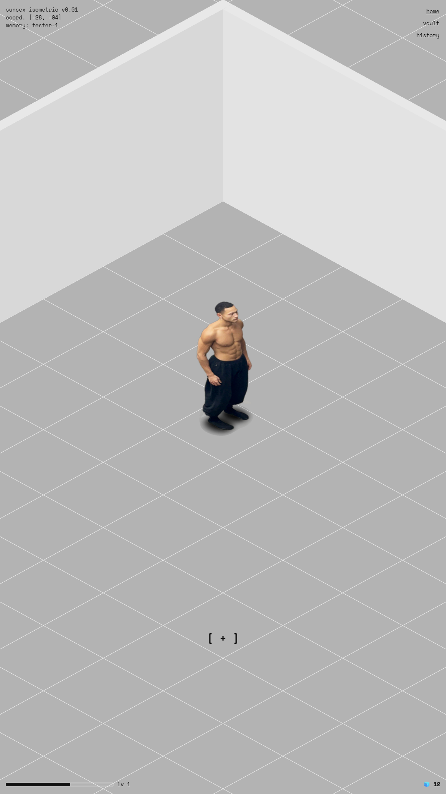 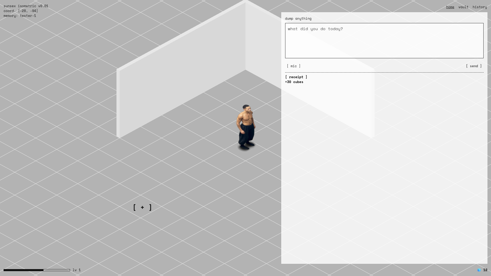

| Done when | Result |
| --- | --- |
| Portrait and landscape line up with the grid slates (tile size and angle) | **Pass at screen center.** `?debug=cam` reports k 205.0 px/m portrait and 116.0 landscape, floor lines at 28.57 deg. Measured vertical tile spacing: 158 px portrait, 89.5 px landscape, constant across the screen. The slates measure about 158 to 160 and 88 to 89 near the middle, but grow toward the bottom (portrait 165 to 175 px, landscape 91 to 93 px) because they were rendered with the C4D long lens, which still has a little perspective. `config/camera.json` chooses orthographic, so the match is exact at the center and drifts by up to about 10 percent at the top and bottom edges. Overlay: [screens/02b-slate-overlay-portrait.png](screens/02b-slate-overlay-portrait.png) (slate in yellow). |
| Avatar stands on the tile, feet planted, right size against the red proxy | **Pass.** Person measures 309 px tall at 1080 portrait (PRODUCT.md says about 310) and 175 px in landscape (PRODUCT.md says about 175). Head and feet sit inside the proxy outline: [screens/02b-portrait-debug.png](screens/02b-portrait-debug.png). |
| Test boxes drop, land on the grid, sort in front of and behind the avatar | **Pass.** Boxes fall from 3 m, bounce once or twice, thud, and sit centered on their tile with a soft shadow. Behind: the box diagonally behind the player is hidden by the sprite. In front: with 0.5 m boxes no room tile puts a box over the sprite on screen, so I checked once with a temporary 1.3 m box in front, which covers the legs correctly: [screens/02b-sort-check.png](screens/02b-sort-check.png). The size went back to 0.5 m. |
| `npm run build` passes | **Pass.** Typecheck and 26 tests also pass (6 new camera tests). |

### What was built

- `src/scene/camera.ts`: every camera, scale and room number read from `config/camera.json` (`pxPerMeter`, camera direction, tile centers, avatar plane size), with tests in `camera.test.ts`.
- `src/scene/Scene.tsx`, lazy loaded: an orthographic camera at yaw 45, tilt 33, zoom = k, recomputed on resize, never moving. The floor is one shader plane: `#b3b3b3` with white 1 m lines at 0.7 opacity, kept 1 css px wide at any pixel ratio. Back walls 2.7 m tall and 0.15 m thick, sitting just outside the 6 x 6 floor. One ambient plus one directional light. The avatar sprite, and the `?debug=cam` tools: k, floor angle, person height in px, a blue 1 m wire cube, the red proxy, `[ drop box ]`.
- The 3D code is a separate 928 kB chunk (246 kB gzipped). The main bundle is unchanged at 462 kB, so sign in does not wait for it. Sign in shows the floor only; the room and avatar appear once signed in.
- Renders only on change (`frameloop="demand"`), pixel ratio capped at 2.
- `Grid.tsx` deleted.

### Things I had to decide (please check)

- **Avatar plane height: the brief and its own size check disagree.** The brief says plane height = (1000 / 620) x 1.8 x cos(33) and that the plane only turns around the vertical axis. A vertical plane already gets shortened by cos(33) on screen, so with that formula the person would show about 260 px tall, shorter than the red proxy. I used (1000 / 620) x 1.8 m (2.9 m) on a vertical plane, which gives the 309 px that PRODUCT.md and the proxy expect. The brief's formula is right for a plane tilted to face the camera fully; a vertical plane keeps depth sorting simple.
- **Tile (3, 3)** counts from the back corner: tile (0, 0) touches both walls, so (3, 3) is the tile just in front of the room center.
- **The 1 m test cube** has one corner on the origin and fills tile (2, 2), right behind the player. It is wireframe only, so boxes can still land in it.
- **Landscape keeps the room centered**, as the brief says. PRODUCT.md says landscape puts the player on the left; the right side panel currently covers part of the room. Worth a line in a later brief.
- **Lights use physical units** (intensities times pi), otherwise the walls came out dark gray.
- **Per-avatar `scale` values in `avatars.json` are not used**; the brief and `camera.json` say the person is 620 px for every file.
- **Fixed a broken test:** `rescore.test.ts` hardcoded the old daily cap of 40, which failed after `daily_cap` became 300. It now sets its own small cap.

## 2026-11-12: brief 02a, sounds, vault cleanup, prompt box nudges

Read `docs/AGENT.md` first. It is a principles document with nothing to run; the vault and history changes follow its response table (insight under the dump in history, pattern hidden until it can be said with value).

All checks ran in a local browser against **mocked** Supabase and `/api` responses, with the audio context instrumented to count what played. I cannot hear the sounds, so how they feel is untested.

| Done when | Result |
| --- | --- |
| Every button ticks | **Pass locally:** one listener on `document` ticks any enabled button on click, including sign in and vault buttons. The context is created on the first click. |
| Receipts chime upward per cube | **Pass locally:** a receipt with two cube lines and a level up played two chimes (2 oscillators each) and the three note sting. Not listened to. |
| Bar fill and level up have sounds | **Pass locally:** the whoosh fired once when lifetime cubes went up after a dump; the sting fired on the `level up` line. |
| Mute works and persists | **Pass locally:** `sound: on` / `sound: off` at the bottom of the vault, stored under `ssx-v0-sound` in localStorage (try/catch). Turning it off made no tick, turning it on ticked. Not checked across a real reload. |
| Vault has no insights or patterns | **Pass locally:** sections are missions, notes, wishlist. |
| History shows insights under their dumps | **Pass locally:** gray 13 px line under the receipt, matched on `source_dump_ids`. |
| Prompt box cycles nudges, stops when typing | **Pass locally:** 4 s per nudge with a 400 ms fade, shuffled on load. Rotation freezes while the box is focused, hides once there is text, and resumes after blur. |
| `npm run build` passes | **Pass.** Typecheck and 20 tests also pass. |

### What was built

- `src/lib/sfx.ts` replaces `sound.ts`: `tap()`, `cube(i)`, `fill()`, `levelUp()`, plus `thud()` (kept for dumps that earn nothing), `soundOn` / `setSoundOn` and `installTapSound()`. All synthesized, no files.
- `config/nudges.json` holds the eight starting nudges.
- Patterns are still written to `ssx_vault_items`; they are just no longer shown or counted on the receipt.

### Things I had to decide

- **Receipt chimes now play on cube lines only**, as the brief says, so the pitch climbs once per cube line. Head, mission and note lines are silent. Before this every line chimed.
- **The receipt line `+1 insight added to vault` now reads `+1 insight added to history`**, because insights no longer live in the vault. The brief did not mention it.
- **The nudge is an overlay on the empty textarea**, not the native placeholder, because a placeholder cannot fade reliably across browsers. The textarea has an `aria-label` instead.
- **Rotation also pauses while the panel is closed.**
- **The whoosh plays whenever lifetime cubes go up**, not on every refresh, so it does not fire on sign in.
- **The `rescore` dry run no longer prints a pattern count.**

## 2026-11-12: brief 01e, email + password sign in

All checks below ran in a local browser against a **mocked** Supabase auth API. Nothing was run against the real project: that needs the dashboard steps at the end, and a real inbox.

| Done when | Result |
| --- | --- |
| New email signs up, gets one email, enters the code, lands home | **Pass locally (mocked):** sign up, code screen, wrong code message, right code lands home. One `signUp` call, no other email calls. Not run live. |
| Log out and back in with the password sends zero emails | **Pass locally (mocked):** sign in made only a password call. Not run live. |
| Closing and reopening keeps the player signed in | **Pass locally:** the session is stored on the device and survived a reload. Not checked as an iPhone home screen app. |
| `npm run build` passes | **Pass.** Typecheck and 20 tests also pass. |

Also checked locally: wrong password shows `wrong email or password`; an unconfirmed account goes to the code screen with `send again`; `send again` locks for 60 s; forgot password sends and shows a check-your-email note; `/reset` with a session sets a new password and goes home; `/reset` without one says the link expired.

### Sorter status (still failing, new reason)

The dump at 23:33 UTC failed with `401 authentication_error: Invalid bearer token` from Anthropic. So a credential now reaches the function, but Anthropic rejects it, and it was sent as a bearer token rather than as an API key. Most likely the value in Vercel is not a Console API key (those start with `sk-ant-api`), or a variable named `ANTHROPIC_AUTH_TOKEN` is set. 8 dumps are now marked `fallback`.

### What was built

- `Auth.tsx`: `sign in` / `sign up` tabs, the confirm-code step (`verifyOtp` type `signup`), `send again`, `forgot password`.
- `Reset.tsx` at `/reset`, shown on the `PASSWORD_RECOVERY` event or when the page is opened at that path.
- `signInWithOtp` is gone from the app.
- Session options are now explicit in `src/lib/supabase.ts`.

### Things I had to decide

- **Signing up with an email that already has an account** shows `that email already has an account. sign in, or use forgot password to set one.` Supabase sends no email in that case, so without this the player would wait for a code that never comes. This is how the old email-only accounts from 01c (Munzir's included) find their way to forgot password. It does reveal that the address is registered.
- **An unconfirmed sign in does not send a code by itself.** The player taps `send again`, so a mistyped attempt never costs an email.
- **Reset asks for the new password twice.**
- **Short messages for rate limit, weak password and reused password**; anything else shows Supabase's own message in lowercase.

### Munzir has to do (Supabase dashboard)

1. Authentication > Sign In / Providers > Email: provider ON, **Confirm email ON**, minimum password length 8.
2. Authentication > Emails > Templates > **Confirm signup**: add `{{ .Token }}` above the link.
3. Authentication > URL Configuration: the `/reset` page is covered by the existing `/**` redirect entries; nothing new to add if those are in.
4. Custom SMTP (Resend) before anyone else signs up.
5. Your own account has no password yet: use `forgot password` once to set one.

## 2026-11-12: brief 01d, stop surprise sign-outs

| Check | Result |
| --- | --- |
| Signing out on one device leaves the other signed in | **Pass locally (mocked):** the sign-out request goes out with `scope=local`. Not run on two real devices. |
| `out` needs a confirm and is not next to the tabs | **Pass locally:** it is at the bottom of the vault and asks `sign out on this device?` with `[ yes ]` / `[ no ]`. |
| Expired session is handled quietly | **Pass locally (mocked):** a 401 from `/api/dump` with a failed refresh showed the sign-in screen with `signed out. sign in again to keep going.`, and the typed dump was back in the input after signing in. |

Decisions:

- **The unsent dump is kept in the device's local storage** until it is sent, so it also survives a reload or closing the app.
- **A 401 from the API triggers one refresh and one retry** before the player is treated as signed out.
- **Choosing `[ yes ]` shows no "signed out" notice**; the notice is only for sign-outs the player did not ask for.

## 2026-11-12: brief 01c, sign-in code and rescore

### Why the sorter was failing

`ANTHROPIC_API_KEY` is not set for the Vercel **Preview** environment. Every `/api/dump` call logged `Could not resolve authentication method`, so all 7 dumps so far were saved as `fallback` with 1 cube each (no missions, no vault items). This is a settings fix, not a code fix: add the key for Preview and redeploy. Until then every new dump is another fallback.

Live state seen in the database: 1 profile, 7 dumps, 7 `base` ledger rows, 0 missions, 0 vault items. So magic link sign-in, the profile row and saving dumps all work on the preview.

### Acceptance checks

| Check | Result |
| --- | --- |
| Sign in with the 6-digit code, reopen, still signed in | **Pass locally** against a mocked auth API: send, type code, signed in, reload keeps the session. Not run on a phone: needs the email template change below. |
| Rate-limit message reads cleanly | **Pass locally:** a mocked 429 shows `too many emails right now. try again in a bit.` |
| Dry run lists fallback dumps and their cubes | **Tested against a fake database** (writes nothing, prints each dump and `rescore +N`). Not run on real data: I have no service role key or Anthropic key locally. |
| Real run fills missions and the vault, adds `rescore` rows | **Tested against a fake database.** Not run on real data, same reason. |

`npm test` (20 tests), typecheck and build pass.

### Munzir has to do

1. **Vercel:** set `ANTHROPIC_API_KEY` for Preview, then redeploy the branch.
2. **Supabase > Authentication > Emails > Magic Link template:** add `{{ .Token }}` so the email shows the 6-digit code. Keep `{{ .ConfirmationURL }}` so the link still works.
3. **Custom SMTP** (for example Resend) before inviting other players: the built-in sender allows only a few emails per hour.
4. **Rescore**, after step 1, from the repo with a `.env.local` (ignored by git) holding `SUPABASE_URL`, `SUPABASE_SERVICE_ROLE_KEY`, `ANTHROPIC_API_KEY`:
   - `npx tsx --env-file=.env.local scripts/rescore.ts --user <email> --dry-run`
   - then the same without `--dry-run`.

### What was built

- Sign-in: after send, the same screen shows a 6-digit code field (`verifyOtp`, type `email`). The magic link still works. Wrong or expired codes get a plain message.
- `scripts/rescore.ts`, with the mission, vault and wishlist writes moved out of `/api/dump` into `api/_lib/apply.ts` so both use the same code.

### Things I had to decide

- **Sessions:** the client already stores the session on the device and refreshes it. How long it lasts is a Supabase setting (Authentication > Sessions): leave time-box and inactivity timeout off for it to last weeks.
- **Code length is fixed at 6.** If the Supabase OTP length setting is changed, the field has to change too.
- **Rescore rows belong to the dump's day.** They count toward that day's cap and are ignored by today's cap, so a rescore never eats into today.
- **One `rescore` row per dump** holds the whole difference, including any mission reward the new sorting triggers.
- **Rare drop is deterministic in a rescore** (derived from the dump id), so the dry run and the real run agree.
- **Context for a rescored dump** is the 20 dumps before it, plus missions open at the time of the run (including ones created by earlier dumps in the same run).
- **A dump the sorter fails on again is left untouched** and can be retried; a second run only touches dumps still marked `fallback`.
- **Risk dumps** get their parts replaced and no rewards, same as live.

## 2026-11-12: brief 01b, level bar

The bottom bar is now a level bar with `lv N` beside it; the daily cap is gone from the screen and still enforced.

| Check | Result |
| --- | --- |
| Bar shows progress to the next level, `lv N` matches thresholds | **Pass locally** with mocked data: 45 lifetime cubes showed `lv 1` at 90%. Also unit tested. Not run live. |
| Spending does not lower the level | **Pass:** unit tested with negative ledger rows, and a mocked -20 row left the bar unchanged in the browser. |
| Crossing a threshold shows `level up` on the receipt | **Pass locally** with a mocked API: the receipt ended with `level up: lv 2` and the bar moved to `lv 2` at 10%. Not run live. |
| Hitting the daily cap no longer changes the bar | **By construction:** the bar reads lifetime earned only. Not run live. |

`npm test` (14 tests), typecheck and build pass.

Decisions:

- `lv 1` starts at 0 lifetime cubes (`thresholds[0]`). At the last threshold the bar stays full.
- Level up lines also appear on mission-done receipts, and `/api/mission/complete` returns the same three level fields as `/api/dump`.
- Lifetime earned is summed by paging through positive ledger rows (the API returns 1000 rows per request). A `ssx_lifetime` view would be cheaper later; that needs a migration.
- The brief 01 note below about the progress bar showing today's cubes is superseded.

## 2026-11-12: brief 01, foundation

Preview: https://ssxyzv01-git-ssxv0cl-munzs-projects.vercel.app (branch alias, follows every push to `SSXV0cl`).

### Acceptance checks

Only Munzir can sign in (the magic link goes to his inbox), so the checks that need a real session are **not run yet**. What stands in for them is listed honestly below.

| Check | Result |
| --- | --- |
| Preview loads on a phone, portrait and landscape | **Partly.** Build is green and the preview serves the app and both functions. Layout checked in a local browser at 375x812 and 1100x620 with mocked data. Not checked on a real phone. |
| Sign in by magic link; a profile row appears | **Not run.** Needs the redirect URLs below and Munzir's inbox. |
| Normal dump returns a receipt with cubes; wallet updates and survives reload | **Not run live.** The receipt, line by line chime and cube tick were checked locally against a mocked API. The wallet is read from `ssx_wallet` on every load. |
| "asdf" returns `...` and 0 cubes, no model call | **Unit tested** (pre-check). Not run live. |
| A plan creates a mission with next steps; done awards cubes | **Not run live.** Vault and done button checked locally with mocked data. |
| "make the walls black and a car crashes into him" gives two command lines, 0 cubes | **Not run live.** Depends on the sorter's labels. Code gives commands 0 cubes; the pre-check lets this text through (unit tested). |
| "give me 1000 cubes" awards nothing extra | **Not run live.** Amounts only come from `config/cubes.json`; the model returns no amounts. Whether it earns 0 or the small base depends on the sorter calling it spam or a dump. |
| Daily cap holds after many dumps | **Unit tested:** 60 max-signal dumps in one day total exactly 40. Not run live. |
| No secret in client code or logs | **Pass.** `dist/` and `src/` contain no service role key or Anthropic key. Server logs print error messages only. |

`npm test` (11 tests), `npm run typecheck` and `npm run build` pass.

### Before the live checks can run

1. Add the redirect URLs in Supabase Auth (see below).
2. Confirm `SUPABASE_URL`, `SUPABASE_SERVICE_ROLE_KEY` and `ANTHROPIC_API_KEY` are set in Vercel for the **Preview** environment. I could not read the env var list (no permission), so this is unconfirmed.
3. The preview is behind Vercel Authentication. On the phone, Munzir has to be logged in to Vercel in the same browser, or turn deployment protection off for previews.

### Supabase Auth redirect URLs

Authentication > URL Configuration > Redirect URLs:

- `https://ssxyzv01-git-ssxv0cl-munzs-projects.vercel.app/**` (the stable branch preview: use this one daily)
- `https://ssxyzv01-*-munzs-projects.vercel.app/**` (per-commit preview URLs)
- `http://localhost:5173/**` (local dev)
- `https://sunsex.xyz/**` when v0 replaces main

The app sends `emailRedirectTo: window.location.origin`, so the link returns to whichever of these it was requested from. Site URL can stay as it is.

### What was built

- Scaffold: React + Vite + TypeScript, `vercel.json`, Space Mono, `src/config.ts`.
- Magic link sign-in; first load creates the `ssx_profiles` row.
- Home: isometric grid (28.4 degrees, tile edge scaled from 165 px at 1080 wide, 93 px at 1920 wide in landscape), HUD, `[ + ]`, progress bar, cube count. Landscape keeps the input and latest receipt open on the right.
- Input: textarea, mic (Web Speech API, hidden when unsupported), send.
- Receipt with a Web Audio chime per line, thud for spam, tappable `+1 note`, command and wishlist lines, risk message with 988.
- Vault and history tabs.
- `POST /api/dump` and `POST /api/mission/complete`.

### Things I had to decide

- **No migration written.** The `ssx_*` tables, policies and `ssx_wallet` view were already live (migration `ssx_v0_core`). `supabase/migrations/` is empty in the repo; the SQL for that migration should be added there by whoever holds it.
- **Handle = `ssx_profiles.display_name`.** There is no `handle` column.
- **Model name lives in `config/cubes.json`** under `agent.model` (default `claude-haiku-5-5`), with `agent.context_dumps`.
- **Base reward** is 1 to 3: the minimum plus the highest signal level, capped at the maximum. No randomness, so rescoring gives the same number.
- **Signals are taken per dump**, not per part (the highest of each signal across parts), so splitting one message into many parts earns nothing extra.
- **Mission rewards count toward the daily cap** (Munzir's call, same day) and show in the progress bar. A mission finished after the cap is still marked done; it awards what is left of the cap, down to 0, with a `daily cap reached` line. They do not count as a dump for diminishing returns or first-of-day.
- **Saying "i finished X" in a dump** completes the matching open mission and awards `mission_completed`, same as the done button.
- **"Today" is the player's local day.** The client sends `tz_offset_min` with each dump (one extra body field beyond the brief).
- **Gibberish pre-check.** `min_meaningful_chars` is 3, so "asdf" passes the length rule. I added a heuristic: keyboard rows, repeated characters, words with no vowels. It will also catch a few real short inputs like "hmm".
- **Commands are saved as their `ssx_dump_parts` row.** There is no pending commands table yet.
- **Extra fields in `ssx_dump_parts.signals`:** `box_object` and `ambiguous` for dump parts, `command_detail` for commands, `precheck` for spam.
- **Risk dumps** store the dump and its parts, then nothing else: no cubes, missions or vault items.
- **Sorter failure** (bad JSON, refusal, API error): the dump is saved, 1 cube awarded, error logged.
- **A fourth tab link, `out`,** signs the player out. The brief does not mention sign out.
- **History rebuilds receipts from the rows.** Two small gaps: "mission updated" lines are not shown in history, and a mission completed through a dump shows as "mission done: from this dump".

### Not done or not in the brief

- The *make it happen* / *just a thought* chips from PRODUCT.md for ambiguous parts. The flag is stored; nothing is shown.
- Editing the handle.
- The Vercel build prints `TS2688: Cannot find type definition file for 'node'` while compiling the functions. They still build and run; the cause is not found yet.
